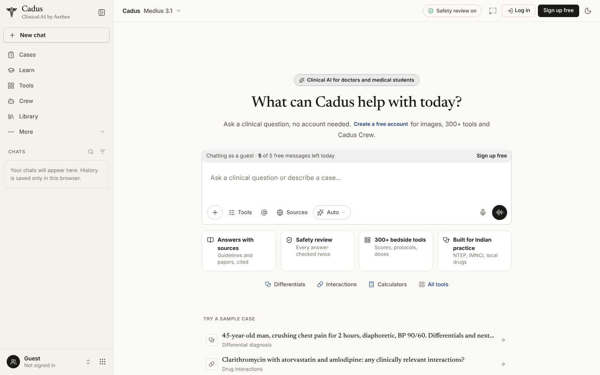
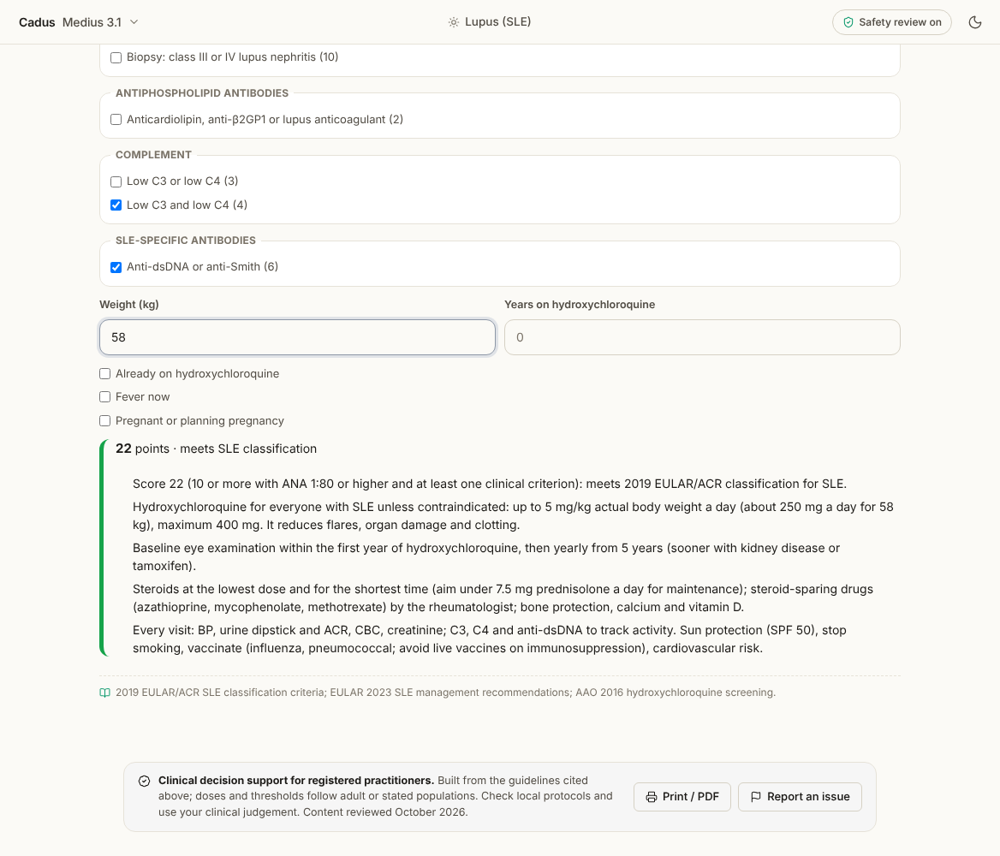
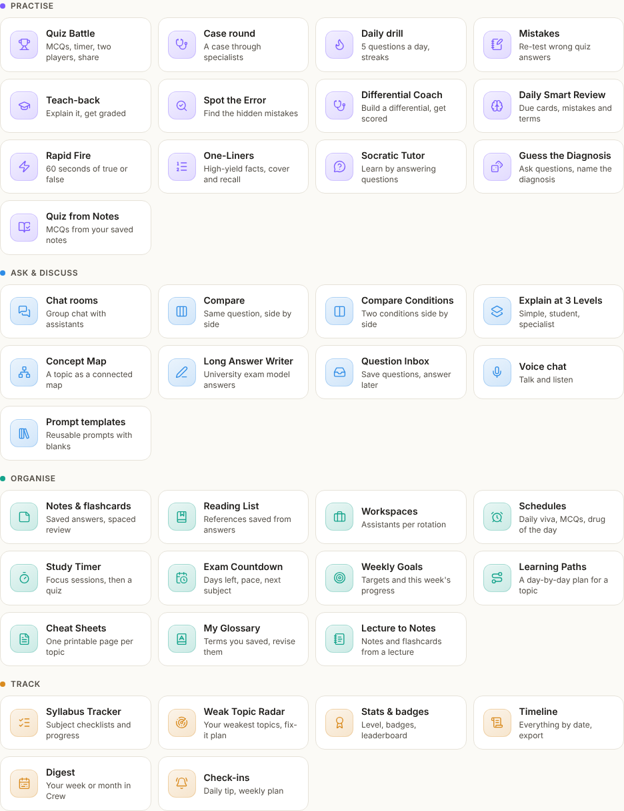
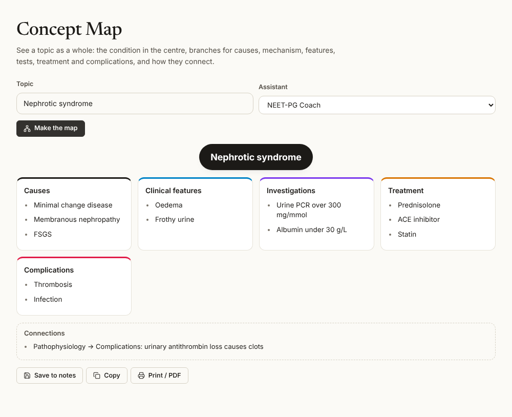
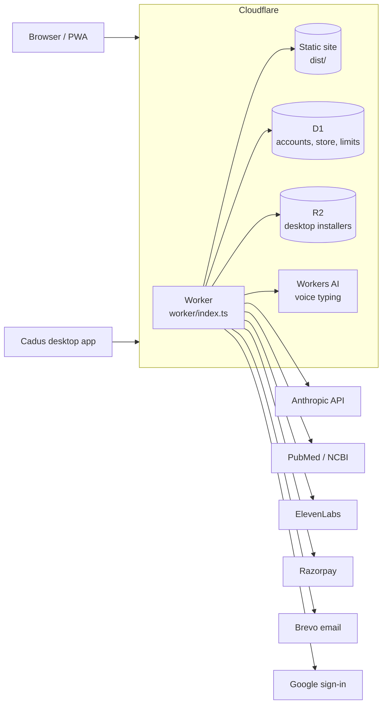

<div align="center">


# AETHEX

**Clinical AI, medical learning and a medical store, in one platform for doctors and medical students in India.**

[Website](https://aethex.in) · [Cadus](https://cadus.aethex.in) · [Desktop app](https://aethex.in/downloads) · [Feature log](docs/CHANGELOG.md) · [Store guide](docs/STORE.md)


</div>

<p align="center">
  
</p>

---

## Contents

- [What AETHEX is](#what-aethex-is)
- [Cadus, the clinical AI](#cadus-the-clinical-ai)
- [Cadus Crew](#cadus-crew)
- [The store](#the-store)
- [Study Hub](#study-hub)
- [Desktop app](#desktop-app)
- [Plans](#plans)
- [Safety and privacy](#safety-and-privacy)
- [Architecture](#architecture)
- [Tech stack](#tech-stack)
- [Getting started](#getting-started)
- [Deployment](#deployment)
- [Configuration](#configuration)
- [Project structure](#project-structure)
- [Author and licence](#author-and-licence)

---

## What AETHEX is

Doctors and students jump between many apps: one for clinical questions, another for dose
calculations, another for exam preparation, another to buy a stethoscope. AETHEX puts these in
one place.

| | Product | What it does | Where |
|---|---|---|---|
| 🩺 | **Cadus** | Clinical AI chat with sources and a safety review, plus 320+ bedside tools | [cadus.aethex.in](https://cadus.aethex.in) |
| 🎓 | **Cadus Crew** | 158 specialist and study assistants, quizzes, flashcards, tutors and exam planners | Inside Cadus |
| 🛒 | **Store** | 366 genuine medical products from 8 brands, with COD, online and bank-transfer payment | [aethex.in/shop](https://aethex.in/shop) |
| 📚 | **Study Hub** | NEET-PG, INI-CET, FMGE, NExT and USMLE resources, books and learning paths | [aethex.in/study-hub](https://aethex.in/study-hub) |
| 💻 | **Desktop app** | Cadus for Windows and Linux, with tray shortcuts and reminders | [aethex.in/downloads](https://aethex.in/downloads) |

---

## Cadus, the clinical AI

Cadus answers clinical questions the way a careful senior would: the bottom line first, key
points, evidence labels, dose cards and numbered sources. Every clinical answer can go through
a second safety review before it is shown.

**Ask**

- Modes beside the message box: Auto, Fast, Think, Exam, Simple and **Deep Dive**, which plans
  the question, searches PubMed and guideline sites step by step, and writes a cited report
- Image and report reading: X-rays, ECGs, skin photos, lab and pathology reports (photo or PDF)
- Voice typing and natural read-aloud voices in English, Hindi and 11 more Indian languages
- Guest chat without an account (a few messages a day); a free account unlocks everything else

**Bedside tools (320+)**, grouped into ten categories and loaded only when opened:

| Area | Examples |
|---|---|
| Emergency & ICU | Chest Pain & ACS, Stroke & Thrombolysis, Sepsis & DKA Bundles, Status Epilepticus, Arrhythmias (ACLS), Poisoning & Snakebite, Ventilator Helper |
| Ward & on-call | Discharge Summary, Shift Handover (I-PASS), Electrolyte Replacement, IV Fluids Planner, AKI, Delirium & 4AT |
| Clinic & OPD | OPD Queue, Prescription Writer, Patient Records, Appointments, Teleconsultation Note, Bills & Accounts |
| Drugs & prescribing | Rx Safety Check, Kidney Dose Adjuster, Antibiotic Guide, Warfarin & Anticoagulation, Deprescribing (STOPP/START) |
| Mother & child | Antenatal Care Tracker, Pre-eclampsia, PPH, Newborn Resuscitation, IMNCI Sick Child, Vaccination Scheduler |
| Diagnosis & evidence | Differential Builder, ECG Reader, Lab Trends, Lupus (SLE), Jaundice and Proteinuria Work-ups, Guideline Watch |
| Documents & legal | Letters & Certificates, Consent Form Writer, MLC Injury Report, Cause of Death (MCCD), ICD-10 Coder |

Indian protocols are built in where they apply: NTEP, NACO, IMNCI, NVBDCP, NRCP, UIP/IAP, ICMR
antibiotic guidance, NLEM and Jan Aushadhi generics.

Every clinical tool ends with its guideline sources, a "content reviewed" date, a **Print / PDF**
button that prints the result on the doctor's own letterhead, and a way to report a problem.

<p align="center">
  
</p>

The full list of tools and what each one does is in the **[feature log](docs/CHANGELOG.md)**.

---

## Cadus Crew

Cadus Crew gives every specialty and every exam its own assistant: 158 built in (cardiology to
forensic medicine, dental, nursing, AYUSH with honest evidence, exam coaches and patient
explainers in 10 Indian languages), plus any you build yourself with your own instructions and
knowledge files.

Around the assistants is a full study toolkit:

- **Practise:** Quiz Battle, Daily Drill, Rapid Fire, Spot the Error, Guess the Diagnosis,
  Differential Coach, Teach-back, Socratic Tutor, High-Yield One-Liners
- **Ask and discuss:** chat rooms with several assistants, side-by-side answers, Compare Two
  Conditions, Explain at 3 Levels, Concept Map, Long Answer Writer for university papers
- **Organise:** notes and spaced-repetition flashcards, glossary, reading list, workspaces per
  rotation, study timer, exam countdown, learning paths, cheat sheets, lecture to notes
- **Track:** syllabus tracker, weak topic radar, stats and badges, timeline and digests

<p align="center">
  
</p>

<p align="center">
  
</p>

---

## The store

Genuine products from **Dr Trust, Tynor, OMRON, Accu-Chek, Rossmax, 3M Littmann, MDF Instruments
and HEINE**: 366 products in 13 categories, from BP monitors and stethoscopes to orthopaedic
supports.

- Cash on delivery, Razorpay (UPI, cards, netbanking, wallets) and bank transfer
- Prices checked again on the server, order emails, tracking by order number and mobile
- Coupons and timed offers, buyer-only reviews approved by an admin, PIN-code delivery check
- Reorders, pay-for-me links, gift orders, GST invoices for clinics, WhatsApp ordering
- An admin at `aethex.in/admin` for orders, refunds, prices, stock, offers and reviews

Setup and payment configuration are in the **[store guide](docs/STORE.md)**.

---

## Study Hub

Resources for NEET-PG, INI-CET, FMGE, NExT and USMLE: coaching comparisons, books, videos,
learning paths, flashcards and quizzes. Inside Cadus, **Learn** adds a syllabus, timed mock tests,
a daily set and spaced review, and the Exam Study Planner builds a day-by-day plan to the exam date.

---

## Desktop app

Cadus 1.0.3 for **Windows** (x64 and ARM64) and **Linux** (AppImage and .deb), built with Electron.

- A secure window onto cadus.aethex.in that keeps the user signed in
- Tray icon, `Ctrl+Shift+Space` quick-open, start with Windows, a Clinic tools menu
- Reminders for flashcards due, open ward jobs and the study plan
- Installers served from Cloudflare R2 at downloads.aethex.in; update check once a day

Build instructions are in [`desktop/README.md`](desktop/README.md).

---

## Plans

| Plan | Price | Who it's for |
|---|---|---|
| Starter | Free | Try Cadus every day, free. Students and first-year residents |
| Core | $10 / month | For the wards and the exam. Residents, interns and aspirants |
| Professional | $35 / month | For practising doctors. Consultants, GPs and clinics |
| Enterprise | On request | For medical colleges and institutions: institution protocols, team packs, admin and usage reports |

Plan limits live in `artifacts/aethex/src/lib/cadus/plans.ts`.

---

## Safety and privacy

Cadus is **clinical decision support** for registered practitioners and students. It does not
replace clinical judgement, local protocols or a qualified doctor.

- **Second review:** clinical answers can be checked by a separate review step, which flags or
  corrects doses and claims before the answer is shown
- **Sources:** answers and tools cite the guidelines and papers they rely on
- **Privacy guard:** patient names and identifiers are removed before anything leaves the device
- **On the device:** patient records, OPD queues, ward lists and study data are kept in the
  browser, with encrypted backup (PBKDF2-SHA256, AES-256-GCM) and restore
- **Server checks:** guest limits, plan limits, rate limits and prices are enforced in the Worker,
  not only in the page
- **Hardening:** security headers (HSTS, nosniff, frame and permissions policies), no secrets in
  the repository, all keys set as Cloudflare secrets

---

## Architecture



One Cloudflare Worker serves the site and every API for **aethex.in**, **cadus.aethex.in**,
**auth.aethex.in**, **login.aethex.in** and **downloads.aethex.in**:

| Route | Handled by |
|---|---|
| `/api/fn/*` | AI functions (Cadus chat, Deep Dive, tools), shared code in `supabase/functions/_shared` run through `worker/deno-shim.ts` |
| `/api/auth/*` | Accounts and sessions in D1 (`worker/auth.ts`) |
| `/api/store/*` | Catalogue, carts, orders and payments (`worker/store.ts`, `worker/razorpay.ts`) |
| `/api/transcribe`, `/api/voice/*` | Voice typing (Workers AI) and natural voices (`worker/transcribe.ts`, `worker/voice.ts`) |
| `/robots.txt`, `/sitemap.xml`, Cadus home | Per-subdomain SEO (`worker/seo.ts`) |
| Everything else | The React single-page app from `dist/` |

Guest access is checked in `worker/guest.ts`, and an hourly cron handles cart reminders and
clean-up.

---

## Tech stack

| Layer | Technology |
|---|---|
| Frontend | React, TypeScript, Vite, Tailwind CSS, wouter, TanStack Query, PWA (Workbox) |
| Backend | Cloudflare Workers (TypeScript) |
| Data | Cloudflare D1 (SQLite), R2, browser storage and IndexedDB for on-device records |
| AI | Anthropic API (text and vision), Workers AI (Whisper) for speech, PubMed for research |
| Voice | ElevenLabs (optional): natural voices, transcription, patient audio, podcasts |
| Payments and email | Razorpay, Brevo |
| Desktop | Electron |
| Tooling | pnpm workspaces, TypeScript 5.9, Wrangler, Playwright for browser tests |

---

## Getting started

**Requirements:** Node.js and pnpm (installs with npm or Yarn are stopped), and a Cloudflare account for deployment.

```bash
git clone https://github.com/sangralrahul/Aethex.git
cd Aethex
npm install -g pnpm
pnpm install
pnpm dev            # http://localhost:8080
```

Other commands:

```bash
pnpm build          # production build into dist/
pnpm start          # preview the production build
pnpm typecheck      # type-check the app
```

AI features need the Worker. To run it locally with the built site:

```bash
pnpm build
npx wrangler dev
```

---

## Deployment

The site deploys to Cloudflare Workers with Wrangler. `wrangler.jsonc` holds the routes, D1, R2,
Workers AI and the hourly cron.

```bash
# once: create the database and apply the migrations
npx wrangler d1 create aethex                      # paste the id into wrangler.jsonc
npx wrangler d1 migrations apply aethex --remote

# secrets (never commit them)
npx wrangler secret put ANTHROPIC_API_KEY
npx wrangler secret put GOOGLE_CLIENT_ID
npx wrangler secret put GOOGLE_CLIENT_SECRET
npx wrangler secret put BREVO_API_KEY

# every release
git push origin main
npx wrangler deploy
```

Store, payment and bank-transfer setup: see the [store guide](docs/STORE.md).

---

## Configuration

All values are Cloudflare Worker secrets or variables (`npx wrangler secret put NAME`).

| Name | Required | Purpose |
|---|---|---|
| `ANTHROPIC_API_KEY` | Yes | Cadus answers, reviews and image reading |
| `GOOGLE_CLIENT_ID`, `GOOGLE_CLIENT_SECRET` | Yes | Sign in with Google |
| `BREVO_API_KEY`, `BREVO_FROM_EMAIL` | Yes | Account and order emails |
| `NCBI_API_KEY` | No | Higher PubMed rate limit for Deep Dive and research |
| `ELEVENLABS_API_KEY` | No | Natural voices, transcription and patient audio |
| `ELEVENLABS_VOICE`, `ELEVENLABS_DAILY_SPEAK`, `ELEVENLABS_DAILY_STT` | No | Default voice and daily allowances |
| `CADUS_GUEST_DAILY`, `CADUS_GUEST_IP_DAILY` | No | Guest messages a day per browser (default 5) and per network (default 40) |
| `ADMIN_EMAILS` | Store | Accounts allowed into the store admin |
| `STORE_EMAIL`, `STORE_WHATSAPP` | No | Order inbox and WhatsApp ordering |
| `STORE_BANK_ACCOUNT_NAME`, `STORE_BANK_ACCOUNT_NUMBER`, `STORE_BANK_IFSC`, `STORE_BANK_NAME` | No | Bank-transfer payment |
| `RAZORPAY_KEY_ID`, `RAZORPAY_KEY_SECRET`, `RAZORPAY_WEBHOOK_SECRET` | No | Online payments (off until both keys are set) |

---

## Project structure

```text
Aethex/
├── artifacts/
│   └── aethex/              # The web app (React + Vite)
│       ├── public/          # Icons, images, _headers, pincodes, product images
│       └── src/
│           ├── pages/       # Site pages; CadusAI.tsx is the Cadus app
│           ├── components/  # UI, including components/cadus/ for every tool view
│           ├── lib/cadus/   # Cadus logic: clinical tools, Crew, privacy, printing
│           └── data/store/  # Store catalogue
├── worker/                  # Cloudflare Worker: API, auth, store, voice, guest access, SEO
├── supabase/functions/      # AI function code shared with the Worker
├── migrations/              # D1 database migrations
├── desktop/                 # Electron desktop app
├── lib/                     # Shared workspace packages
├── scripts/, tools/         # Build and content scripts
├── docs/                    # Feature log, store guide, screenshots
└── wrangler.jsonc           # Cloudflare configuration
```

---

## Author and licence

Built by **Rahul Sangral** · [github.com/sangralrahul](https://github.com/sangralrahul) ·
[aethex.in](https://aethex.in)

Released under the [MIT License](LICENSE).

> **Medical disclaimer:** Cadus provides clinical decision support and educational information.
> It is not a substitute for professional medical judgement, diagnosis or treatment. Always
> verify doses and recommendations against current guidelines and local protocols.
