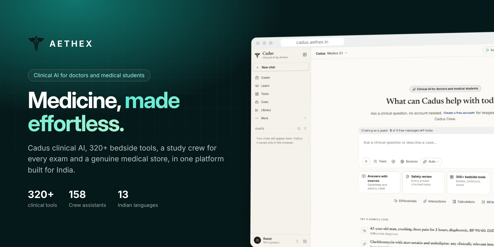
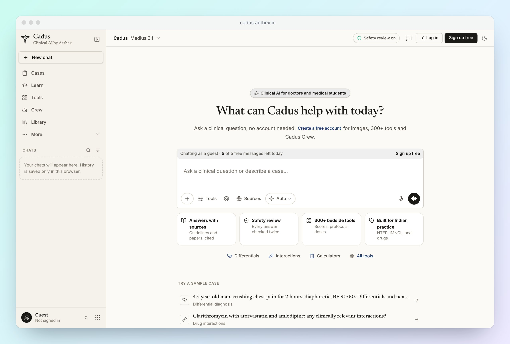
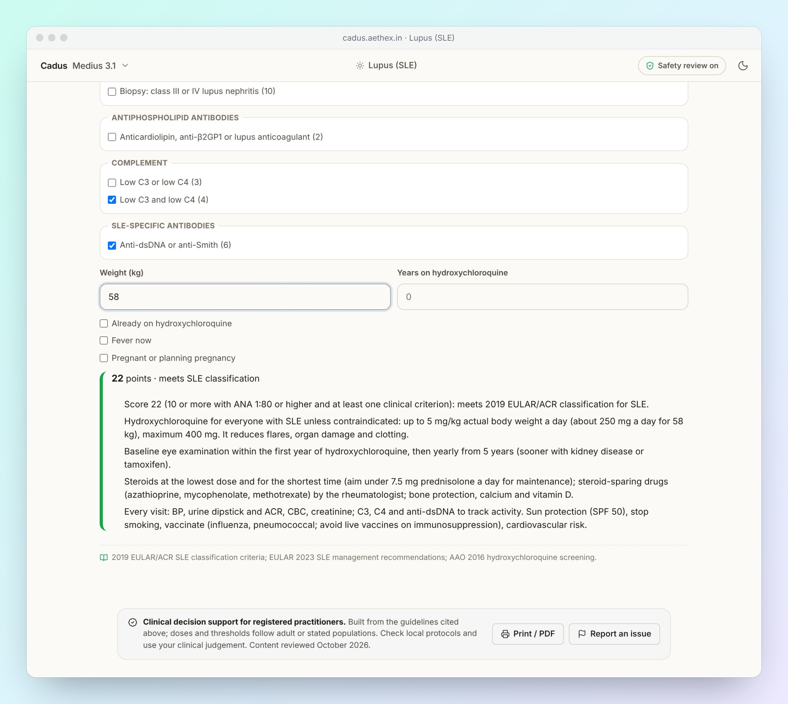
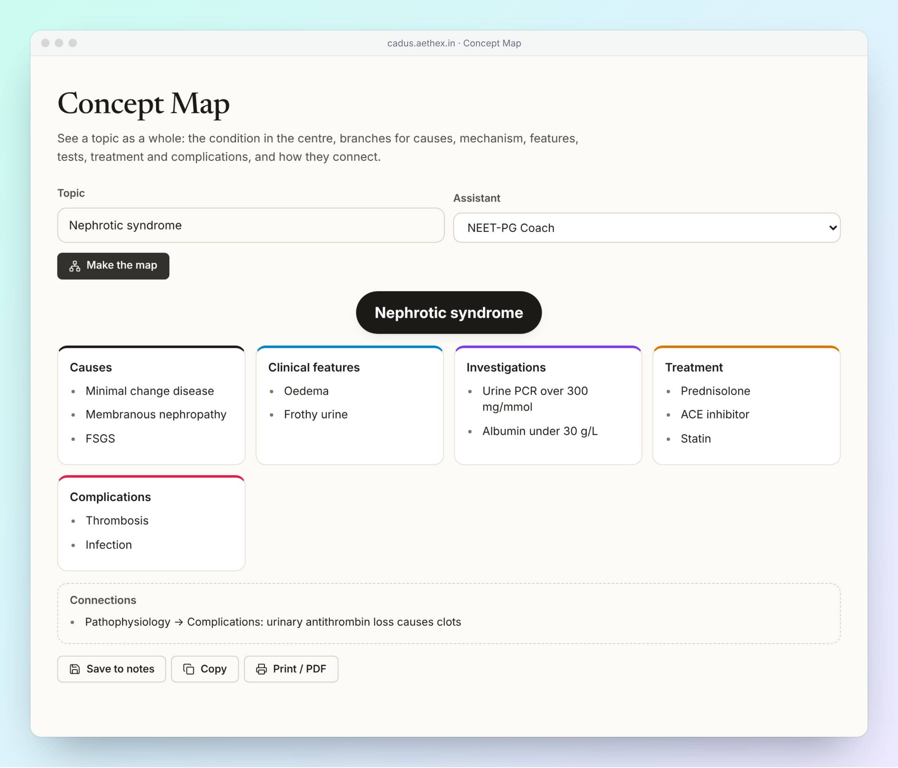

<p align="center">
  
</p>

<p align="center">
  <a href="https://cadus.aethex.in"><b>Try Cadus</b></a>
  &nbsp;&nbsp;·&nbsp;&nbsp;
  <a href="https://aethex.in">Website</a>
  &nbsp;&nbsp;·&nbsp;&nbsp;
  <a href="https://aethex.in/downloads">Desktop app</a>
  &nbsp;&nbsp;·&nbsp;&nbsp;
  <a href="docs/DEVELOPMENT.md">Documentation</a>
</p>

<br />

**AETHEX** is the platform for doctors and medical students in India. It brings clinical AI,
bedside tools, exam preparation and a genuine medical store into one place, so the work of a
clinician — answering, prescribing, learning, buying — happens without switching apps.

<br />

## Cadus

**Clinical answers you can check.** Cadus answers like a careful senior: the bottom line first,
then key points, dose cards and numbered sources. Every clinical answer can pass a second safety
review before you see it. Deep Dive searches PubMed and guideline sites step by step and writes a
cited report.

<p align="center">
  
</p>

<br />

## 320+ bedside tools

**Built on guidelines, ready at the bedside.** Scores, protocols, dose calculators and work-ups
across emergency medicine, wards, clinics, obstetrics and paediatrics, with Indian programmes
such as NTEP, NACO and IMNCI built in. Each tool cites its sources and prints on your own
letterhead.

<p align="center">
  
</p>

<br />

## Cadus Crew

**A study team for every subject and exam.** 158 specialist and exam assistants, with quiz
battles, spaced-repetition flashcards, a Socratic tutor, concept maps, university long answers,
a syllabus tracker and a weak-topic radar — for NEET-PG, INI-CET, FMGE and university exams.

<p align="center">
  
</p>

<br />

## Find a doctor

**Book a checked doctor.** On doctors.aethex.in patients search doctors and clinics by city, specialty, fee,
availability and experience, read patient stories, and book a clinic visit or video consult. They reschedule,
receive printable prescriptions, ask a doctor free, read health articles, and keep health records on their device.
Doctors list their practice free, with a practice dashboard for bookings, prescriptions, leave days, answers and
articles; every registration number is checked before a profile goes live.

<br />

## Store

**Genuine instruments from brands doctors trust.** 366 products from Dr Trust, Tynor, OMRON,
Accu-Chek, Rossmax, 3M Littmann, MDF Instruments and HEINE, with cash on delivery, UPI and cards,
order tracking and GST invoices for clinics. [Store guide](docs/STORE.md)

<br />

## Designed for clinical safety

- **Second review** of clinical answers, with doses and claims checked before they are shown
- **Sources** cited in answers and on every tool
- **Privacy guard** that removes patient names and identifiers before anything leaves the device
- **On-device records**, with encrypted backup and restore

<br />

## Available everywhere

Aethex is one account across its portals: [doctors.aethex.in](https://doctors.aethex.in), [store.aethex.in](https://store.aethex.in),
[study.aethex.in](https://study.aethex.in), [hospitals.aethex.in](https://hospitals.aethex.in) and
[medicalcolleges.aethex.in](https://medicalcolleges.aethex.in).
Use Cadus in the browser at [cadus.aethex.in](https://cadus.aethex.in), install it as an app on
your phone, or download the desktop app for Windows and Linux. Simple chat works without an
account; a free account unlocks images, tools and Cadus Crew.

<br />

## For developers

AETHEX is built with React, TypeScript and Vite, and runs on Cloudflare Workers with D1 and R2.
Setup, architecture, deployment and configuration are in the
**[development guide](docs/DEVELOPMENT.md)**. Every feature, update by update, is in the
**[feature log](docs/CHANGELOG.md)**.

```bash
git clone https://github.com/sangralrahul/Aethex.git && cd Aethex
pnpm install && pnpm dev
```

<br />

---

<p align="center">
  Built by <a href="https://github.com/sangralrahul">Rahul Sangral</a> · <a href="LICENSE">MIT License</a>
</p>

<p align="center">
  <sub>Cadus provides clinical decision support and educational information. It is not a substitute for professional medical judgement. Always verify doses and recommendations against current guidelines and local protocols.</sub>
</p>
