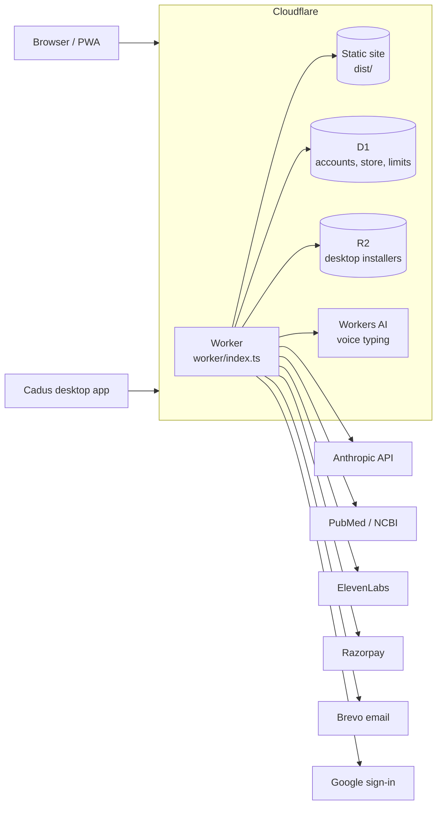

# Developing AETHEX

Plans, safety design, architecture, setup, deployment and configuration. Back to the [README](../README.md).

## Plans

| Plan | Price | Who it's for |
|---|---|---|
| Starter | Free | Try Cadus every day, free. Students and first-year residents |
| Core | $10 / month | For the wards and the exam. Residents, interns and aspirants |
| Professional | $35 / month | For practising doctors. Consultants, GPs and clinics |
| Enterprise | On request | For medical colleges and institutions: institution protocols, team packs, admin and usage reports |

Plan limits live in `artifacts/aethex/src/lib/cadus/plans.ts`.


## Safety and privacy

Cadus is **clinical decision support** for registered practitioners and students. It does not
replace clinical judgement, local protocols or a qualified doctor.

- **Second review:** clinical answers can be checked by a separate review step, which flags or
  corrects doses and claims before the answer is shown
- **Sources:** answers and tools cite the guidelines and papers they rely on
- **Privacy guard:** patient names and identifiers are removed before anything leaves the device
- **On the device:** patient records, OPD queues, ward lists and study data are kept in the
  browser, with encrypted backup (PBKDF2-SHA256, AES-256-GCM) and restore
- **Server checks:** guest limits, plan limits, rate limits and prices are enforced in the Worker,
  not only in the page
- **Hardening:** security headers (HSTS, nosniff, frame and permissions policies), no secrets in
  the repository, all keys set as Cloudflare secrets


## Architecture



One Cloudflare Worker serves the site and every API for **aethex.in**, **cadus.aethex.in**,
**auth.aethex.in**, **login.aethex.in** and **downloads.aethex.in**:

| Route | Handled by |
|---|---|
| `/api/fn/*` | AI functions (Cadus chat, Deep Dive, tools), shared code in `supabase/functions/_shared` run through `worker/deno-shim.ts` |
| `/api/auth/*` | Accounts and sessions in D1 (`worker/auth.ts`) |
| `/api/store/*` | Catalogue, carts, orders and payments (`worker/store.ts`, `worker/razorpay.ts`) |
| `/api/transcribe`, `/api/voice/*` | Voice typing (Workers AI) and natural voices (`worker/transcribe.ts`, `worker/voice.ts`) |
| `/robots.txt`, `/sitemap.xml`, Cadus home | Per-subdomain SEO (`worker/seo.ts`) |
| Everything else | The React single-page app from `dist/` |

Guest access is checked in `worker/guest.ts`, and an hourly cron handles cart reminders and
clean-up.


## Tech stack

| Layer | Technology |
|---|---|
| Frontend | React, TypeScript, Vite, Tailwind CSS, wouter, TanStack Query, PWA (Workbox) |
| Backend | Cloudflare Workers (TypeScript) |
| Data | Cloudflare D1 (SQLite), R2, browser storage and IndexedDB for on-device records |
| AI | Anthropic API (text and vision), Workers AI (Whisper) for speech, PubMed for research |
| Voice | ElevenLabs (optional): natural voices, transcription, patient audio, podcasts |
| Payments and email | Razorpay, Brevo |
| Desktop | Electron |
| Tooling | pnpm workspaces, TypeScript 5.9, Wrangler, Playwright for browser tests |


## Getting started

**Requirements:** Node.js and pnpm (installs with npm or Yarn are stopped), and a Cloudflare account for deployment.

```bash
git clone https://github.com/sangralrahul/Aethex.git
cd Aethex
npm install -g pnpm
pnpm install
pnpm dev            # http://localhost:8080
```

Other commands:

```bash
pnpm build          # production build into dist/
pnpm start          # preview the production build
pnpm typecheck      # type-check the app
```

AI features need the Worker. To run it locally with the built site:

```bash
pnpm build
npx wrangler dev
```


## Deployment

The site deploys to Cloudflare Workers with Wrangler. `wrangler.jsonc` holds the routes, D1, R2,
Workers AI and the hourly cron.

```bash
# once: create the database and apply the migrations
npx wrangler d1 create aethex                      # paste the id into wrangler.jsonc
npx wrangler d1 migrations apply aethex --remote

# secrets (never commit them)
npx wrangler secret put ANTHROPIC_API_KEY
npx wrangler secret put GOOGLE_CLIENT_ID
npx wrangler secret put GOOGLE_CLIENT_SECRET
npx wrangler secret put BREVO_API_KEY

# every release
git push origin main
npx wrangler deploy
```

Store, payment and bank-transfer setup: see the [store guide](STORE.md).


## Configuration

All values are Cloudflare Worker secrets or variables (`npx wrangler secret put NAME`).

| Name | Required | Purpose |
|---|---|---|
| `ANTHROPIC_API_KEY` | Yes | Cadus answers, reviews and image reading |
| `GOOGLE_CLIENT_ID`, `GOOGLE_CLIENT_SECRET` | Yes | Sign in with Google |
| `BREVO_API_KEY`, `BREVO_FROM_EMAIL` | Yes | Account and order emails |
| `NCBI_API_KEY` | No | Higher PubMed rate limit for Deep Dive and research |
| `ELEVENLABS_API_KEY` | No | Natural voices, transcription and patient audio |
| `ELEVENLABS_VOICE`, `ELEVENLABS_DAILY_SPEAK`, `ELEVENLABS_DAILY_STT` | No | Default voice and daily allowances |
| `CADUS_GUEST_DAILY`, `CADUS_GUEST_IP_DAILY` | No | Guest messages a day per browser (default 5) and per network (default 40) |
| `ADMIN_EMAILS` | Store, Find | Accounts allowed into the store admin and to approve doctors on Aethex Find (aethex.in/admin/doctors) |
| `STORE_EMAIL`, `STORE_WHATSAPP` | No | Order inbox and WhatsApp ordering |
| `STORE_BANK_ACCOUNT_NAME`, `STORE_BANK_ACCOUNT_NUMBER`, `STORE_BANK_IFSC`, `STORE_BANK_NAME` | No | Bank-transfer payment |
| `RAZORPAY_KEY_ID`, `RAZORPAY_KEY_SECRET`, `RAZORPAY_WEBHOOK_SECRET` | No | Online payments (off until both keys are set) |


## Project structure

```text
Aethex/
├── artifacts/
│   └── aethex/              # The web app (React + Vite)
│       ├── public/          # Icons, images, _headers, pincodes, product images
│       └── src/
│           ├── pages/       # Site pages; CadusAI.tsx is the Cadus app
│           ├── components/  # UI, including components/cadus/ for every tool view
│           ├── lib/cadus/   # Cadus logic: clinical tools, Crew, privacy, printing
│           └── data/store/  # Store catalogue
├── worker/                  # Cloudflare Worker: API, auth, store, voice, guest access, SEO
├── supabase/functions/      # AI function code shared with the Worker
├── migrations/              # D1 database migrations
├── desktop/                 # Electron desktop app
├── lib/                     # Shared workspace packages
├── scripts/, tools/         # Build and content scripts
├── docs/                    # Feature log, store guide, screenshots
└── wrangler.jsonc           # Cloudflare configuration
```

## The portals (update 58)

aethex.in is the front door. Each part of Aethex has its own subdomain, all served by the same Worker and app
(`wrangler.jsonc` routes; `src/lib/host.ts` `currentPortal()` / `portalUrl()`):

| Host | Opens on | Off the aethex.in domain |
|---|---|---|
| `store.aethex.in` | the medical store | `/store` |
| `study.aethex.in` | the Study Hub | `/study-hub` |
| `find.aethex.in` | Aethex Find (doctors and bookings) | `/find` |
| `hospitals.aethex.in` | Aethex for Hospitals | `/hospitals` |
| `medicalcolleges.aethex.in` | Aethex for Medical Colleges | `/medical-colleges` |
| `cadus.aethex.in` | Cadus | `/ai-assistant` |

Sign-in is shared: `login.aethex.in` sends people back to the portal they came from (`back=` parameter).
After deploying, Cloudflare creates the DNS records and certificates for the new custom domains itself.

## Aethex Find

`worker/find.ts` (`/api/find/*`), tables in `migrations/0006_find.sql` (also created on first use). Doctors list
their own practice at `/list-your-practice`; the profile is `pending` until an account in `ADMIN_EMAILS` approves it
at `/admin/doctors` (check the registration number on the NMC register first). Only `live` doctors appear in search.
Patients book the doctor's free slots (India time, 30 minutes ahead, 30 days out); the doctor confirms, completes or
cancels from `/practice`. Reviews can only be written for `completed` appointments. Emails go through Brevo.
