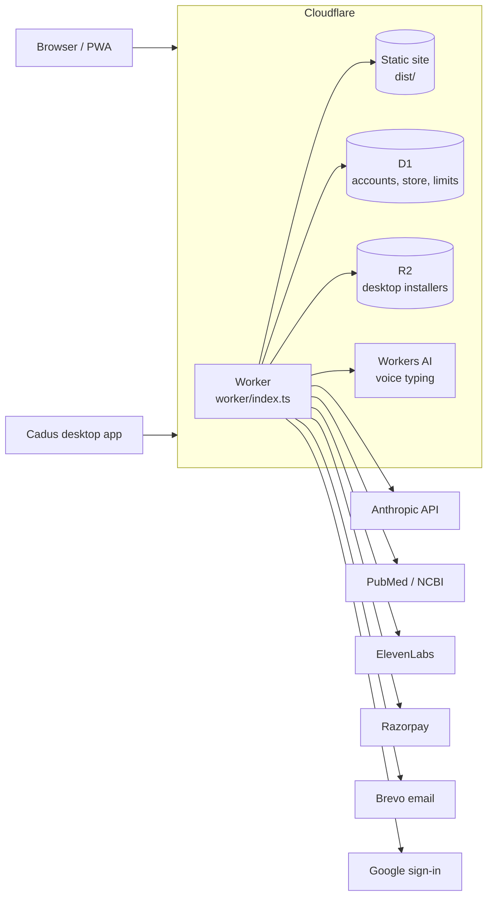

# Developing AETHEX

Plans, safety design, architecture, setup, deployment and configuration. Back to the [README](../README.md).

## Plans

| Plan | Price | Who it's for |
|---|---|---|
| Starter | Free | Try Cadus every day, free. Students and first-year residents |
| Core | $10 / month | For the wards and the exam. Residents, interns and aspirants |
| Professional | $35 / month | For practising doctors. Consultants, GPs and clinics |
| Enterprise | On request | For medical colleges and institutions: institution protocols, team packs, admin and usage reports |

Plan limits live in `artifacts/aethex/src/lib/cadus/plans.ts`.


## Safety and privacy

Cadus is **clinical decision support** for registered practitioners and students. It does not
replace clinical judgement, local protocols or a qualified doctor.

- **Second review:** clinical answers can be checked by a separate review step, which flags or
  corrects doses and claims before the answer is shown
- **Sources:** answers and tools cite the guidelines and papers they rely on
- **Privacy guard:** patient names and identifiers are removed before anything leaves the device
- **On the device:** patient records, OPD queues, ward lists and study data are kept in the
  browser, with encrypted backup (PBKDF2-SHA256, AES-256-GCM) and restore
- **Server checks:** guest limits, plan limits, rate limits and prices are enforced in the Worker,
  not only in the page
- **Hardening:** security headers (HSTS, nosniff, frame and permissions policies), no secrets in
  the repository, all keys set as Cloudflare secrets


## Architecture



One Cloudflare Worker serves the site and every API for **aethex.in**, **cadus.aethex.in**,
**auth.aethex.in**, **login.aethex.in** and **downloads.aethex.in**:

| Route | Handled by |
|---|---|
| `/api/fn/*` | AI functions (Cadus chat, Deep Dive, tools), shared code in `supabase/functions/_shared` run through `worker/deno-shim.ts` |
| `/api/auth/*` | Accounts and sessions in D1 (`worker/auth.ts`) |
| `/api/store/*` | Catalogue, carts, orders and payments (`worker/store.ts`, `worker/razorpay.ts`) |
| `/api/transcribe`, `/api/voice/*` | Voice typing (Workers AI) and natural voices (`worker/transcribe.ts`, `worker/voice.ts`) |
| `/robots.txt`, `/sitemap.xml`, Cadus home | Per-subdomain SEO (`worker/seo.ts`) |
| Everything else | The React single-page app from `dist/` |

Guest access is checked in `worker/guest.ts`, and an hourly cron handles cart reminders and
clean-up.


## Tech stack

| Layer | Technology |
|---|---|
| Frontend | React, TypeScript, Vite, Tailwind CSS, wouter, TanStack Query, PWA (Workbox) |
| Backend | Cloudflare Workers (TypeScript) |
| Data | Cloudflare D1 (SQLite), R2, browser storage and IndexedDB for on-device records |
| AI | Anthropic API (text and vision), Workers AI (Whisper) for speech, PubMed for research |
| Voice | ElevenLabs (optional): natural voices, transcription, patient audio, podcasts |
| Payments and email | Razorpay, Brevo |
| Desktop | Electron |
| Tooling | pnpm workspaces, TypeScript 5.9, Wrangler, Playwright for browser tests |


## Getting started

**Requirements:** Node.js and pnpm (installs with npm or Yarn are stopped), and a Cloudflare account for deployment.

```bash
git clone https://github.com/sangralrahul/Aethex.git
cd Aethex
npm install -g pnpm
pnpm install
pnpm dev            # http://localhost:8080
```

Other commands:

```bash
pnpm build          # production build into dist/
pnpm start          # preview the production build
pnpm typecheck      # type-check the app
```

AI features need the Worker. To run it locally with the built site:

```bash
pnpm build
npx wrangler dev
```


## Deployment

The site deploys to Cloudflare Workers with Wrangler. `wrangler.jsonc` holds the routes, D1, R2,
Workers AI and the hourly cron.

```bash
# once: create the database and apply the migrations
npx wrangler d1 create aethex                      # paste the id into wrangler.jsonc
npx wrangler d1 migrations apply aethex --remote

# secrets (never commit them)
npx wrangler secret put ANTHROPIC_API_KEY
npx wrangler secret put GOOGLE_CLIENT_ID
npx wrangler secret put GOOGLE_CLIENT_SECRET
npx wrangler secret put BREVO_API_KEY

# every release
git push origin main
npx wrangler deploy
```

Store, payment and bank-transfer setup: see the [store guide](STORE.md).


## Configuration

All values are Cloudflare Worker secrets or variables (`npx wrangler secret put NAME`).

| Name | Required | Purpose |
|---|---|---|
| `ANTHROPIC_API_KEY` | Yes | Cadus answers, reviews and image reading |
| `GOOGLE_CLIENT_ID`, `GOOGLE_CLIENT_SECRET` | Yes | Sign in with Google |
| `BREVO_API_KEY`, `BREVO_FROM_EMAIL` | Yes | Account and order emails |
| `NCBI_API_KEY` | No | Higher PubMed rate limit for Deep Dive and research |
| `ELEVENLABS_API_KEY` | No | Natural voices, transcription and patient audio |
| `ELEVENLABS_VOICE`, `ELEVENLABS_DAILY_SPEAK`, `ELEVENLABS_DAILY_STT` | No | Default voice and daily allowances |
| `CADUS_GUEST_DAILY`, `CADUS_GUEST_IP_DAILY` | No | Guest messages a day per browser (default 5) and per network (default 40) |
| `ADMIN_EMAILS` | Store, Find | Accounts allowed into the store admin and to approve doctors on Aethex Doctors (aethex.in/admin/doctors) |
| `STORE_EMAIL`, `STORE_WHATSAPP` | No | Order inbox and WhatsApp ordering |
| `STORE_BANK_ACCOUNT_NAME`, `STORE_BANK_ACCOUNT_NUMBER`, `STORE_BANK_IFSC`, `STORE_BANK_NAME` | No | Bank-transfer payment |
| `RAZORPAY_KEY_ID`, `RAZORPAY_KEY_SECRET`, `RAZORPAY_WEBHOOK_SECRET` | No | Online payments (off until both keys are set) |


## Project structure

```text
Aethex/
├── artifacts/
│   └── aethex/              # The web app (React + Vite)
│       ├── public/          # Icons, images, _headers, pincodes, product images
│       └── src/
│           ├── pages/       # Site pages; CadusAI.tsx is the Cadus app
│           ├── components/  # UI, including components/cadus/ for every tool view
│           ├── lib/cadus/   # Cadus logic: clinical tools, Crew, privacy, printing
│           └── data/store/  # Store catalogue
├── worker/                  # Cloudflare Worker: API, auth, store, voice, guest access, SEO
├── supabase/functions/      # AI function code shared with the Worker
├── migrations/              # D1 database migrations
├── desktop/                 # Electron desktop app
├── lib/                     # Shared workspace packages
├── scripts/, tools/         # Build and content scripts
├── docs/                    # Feature log, store guide, screenshots
└── wrangler.jsonc           # Cloudflare configuration
```

## The portals (update 58)

aethex.in is the front door. Each part of Aethex has its own subdomain, all served by the same Worker and app
(`wrangler.jsonc` routes; `src/lib/host.ts` `currentPortal()` / `portalUrl()`):

| Host | Opens on | Off the aethex.in domain |
|---|---|---|
| `store.aethex.in` | the medical store | `/store` |
| `study.aethex.in` | the Study Hub | `/study-hub` |
| `doctors.aethex.in` | Aethex Doctors (find.aethex.in redirects here) | `/find` |
| `hospitals.aethex.in` | Aethex for Hospitals | `/hospitals` |
| `medicalcolleges.aethex.in` | Aethex for Medical Colleges | `/medical-colleges` |
| `cadus.aethex.in` | Cadus | `/ai-assistant` |

Sign-in is shared: `login.aethex.in` sends people back to the portal they came from (`back=` parameter).
After deploying, Cloudflare creates the DNS records and certificates for the new custom domains itself.

### Each portal stands on its own (update 65)

On the aethex.in domain each subdomain shows only its own platform: its own header and footer
(`src/components/layout/PortalChrome.tsx`, configured per portal in `PORTALS` in `src/lib/portals.ts`), with no
switcher and no links to the other platforms. `aethex.in` itself shows only the front door with the five dashboards.

- `portalForPath()` maps every path to the portal it belongs to (shared pages such as sign-in, account, contact and
  the policies stay where they are opened).
- `misplaced()` sends a page opened on the wrong host to its own portal (`PortalGuard` in `App.tsx`), keeping the
  query and `#hash`; a portal's home route (`/store`, `/find`, `/hospitals`, `/medical-colleges`) becomes `/`. This
  runs in the browser because Cloudflare serves most paths from static assets without the Worker.
- The catalogue (`/products`, `/shop`, `/category`, `/brand`, `/books`), the cart and checkout also open on the
  hospitals and medical-colleges portals, which build their lists from it and order small lists through the cart.
- Browser storage is per subdomain, so a bulk list lives on its own portal: `bulkListAt()` decides whether a product
  page adds to the list here or links to the same page on that portal.
- `canonicalFor()` (used by `useSeo`) gives each page's canonical address on its own portal.
- The floating Cadus button is hidden on every aethex.in host.

### The hospitals and medical-colleges pages (update 66)

`src/pages/BulkPortal.tsx`: a hero with the platform's own colour (`.ax-bulk.seg-hospital` / `.seg-college` in
`src/shop.css`), the four assurances, a card per department, ready-made lists, then the catalogue: search, and one
department at a time in tabs (`short` names in `src/config/institutions.ts`; `#icu` and the like open that tab).
How it works, the brands in the catalogue (counted from the store data), questions and a closing call to action follow.
The figures in the hero (products, brands, departments) are counted from the catalogue, never typed in.

Update 67: the Doctors home (`src/pages/find/FindHome.tsx`, `.fd-hero2`) and the Study home (`src/pages/StudyHub.tsx`,
`.ax-sth-hero2`) use the same hero (`.ax-ihero` in `src/shop.css`) in their own colours; the Study pages' accents are
violet (`.ax-sth` redefines the `--ax-teal*` tokens).

Update 68: `src/components/visual/HeroScene.tsx` is the living background behind every platform hero and the store's
banner: a network canvas (paused off screen and with reduced motion), a themed animation (heartbeat, molecules, DNA,
crosses) and "X-ray" ghosts of our own product photos. `src/lib/reveal.ts` (started by the portal header) makes cards
and headings rise into view on scroll; it marks elements with `data-axrv` and the classes `ax-rv`/`ax-rv-in`, because
`data-rv` and `.rv` already belong to the older homepage and downloads animations. The Knowledge Hub
(`src/pages/StudyHub/MedicalKnowledgeHub/`) uses the same hero (`KhHero` in `src/components/MedKnowledge/KhParts.tsx`),
line icons instead of emoji, Study's violet, figures counted from the data, and light backgrounds for its diagrams.

Update 69: `PageHero` (the header of the inner pages) takes the colour and living background of the platform it is on.
Doctors pages use the Doctors blue and dark page banners (`.fd-pagehead`). Rule kept since: no invented figures,
people, ratings or accreditations. The CME Hub (`src/pages/CmeHub.tsx`) lists refresher modules that open the
Knowledge Hub and says plainly that they carry no CME credit; `/cme-certificate` issues no certificates; Mentorship
lists no mentors until real doctors agree to mentor.

Update 70: `src/components/visual/CardArt.tsx` draws a card's background picture for its category (the category's
illustration large and faded, a glow and a turning orbit in its colour, brighter on hover). A card that uses it has the
class `has-art` and `<CardArt>` as its first child. It is on subject, department, topic and condition cards, the
Study tools, flashcard decks, clinical tools, CME modules, the Doctors services and health concerns, the hospital and
college departments and ready-made lists, and the Store's practice, promo and promise cards. Shaded section bands carry a
drifting dot pattern. Do not name a class `ring`: Tailwind's `.ring` draws an outline.

Update 71, the marketplace redesign: every platform uses the Store's layout. The portal header has two rows: logo, a
wide search bar (each platform searches its own content: products, doctors, Knowledge Hub topics, or the catalogue for
hospitals and colleges) and account; then a category strip (`PORTALS[...].links`, plus `help` at its right end; Doctors
keeps its own FindNav strip). Each home page starts with `MarketTop` (`src/components/layout/MarketTop.tsx`): a title
strip with the page's search or actions, departments on the left, a rotating banner with product photos and the living
background, two promo tiles, and a strip of promises. It reuses the Store's `ec-*` styles; `.mk-<portal>` sets the
colours. The Knowledge Hub reads `?q=` from the header search.

Update 72: doctors register without an Aethex account. Signed out, `/list-your-practice` shows the full form with an
email and mobile; it posts to `POST /api/find/register` (5 a day per connection; one practice per registration number
and per email). The profile is saved `pending` with `user_id = 'reg:…'` and `contact_email` / `contact_phone`
(migration 0008, also added on first use); the admin and the doctor are emailed. When someone signs in with that email
(by a code or Google, so the email is proven), the profile becomes theirs. Booking and approval emails go to the
account's email, or to `contact_email` until then.

Update 73: aethex.in (`src/pages/Hub.tsx`) has one search across doctors, products and study topics (it opens the
right platform with the search done), and each of the five cards links straight to its platform's four most common
tasks, with the button in the platform's colour and its address underneath. On phones the cards drop the picture and
show the tasks as a grid of buttons, so all five fit in a short scroll.

## Aethex Doctors

`worker/find.ts` (`/api/find/*`), tables in `migrations/0006_find.sql` (also created on first use). Doctors list
their own practice at `/list-your-practice`; the profile is `pending` until an account in `ADMIN_EMAILS` approves it
at `/admin/doctors` (check the registration number on the NMC register first). Only `live` doctors appear in search.
Patients book the doctor's free slots (India time, 30 minutes ahead, 30 days out); the doctor confirms, completes or
cancels from `/practice`. Reviews can only be written for `completed` appointments. Emails go through Brevo.

### Aethex Doctors features (update 64)

- Search filters: city, specialty, availability (today, tomorrow, 7 days), fee, experience, gender, video; sort by
  relevance, experience, rating or fee. `/clinics` groups live doctors by clinic; `/clinic/:key` lists its doctors.
- Profiles: education, awards, memberships, leave days (`/me/timeoff`), and tabs for Info, Patient stories
  (rating, recommend, waiting time, the doctor's reply), Consult Q&A and Articles.
- Patients reschedule (`/appointments/:id/reschedule`); doctors write prescriptions
  (`/practice/appointments/:id/prescription`), which complete the visit and open as a printable page `/prescription/:id`.
- Ask a doctor (`/ask`): public questions without names (phone numbers and emails refused); only approved doctors
  answer; readers mark answers helpful. Health articles (`/articles`): only approved doctors publish.
  Admins remove posts with `POST /api/find/admin/remove`.
- Health records (`/records`) stay in the browser (IndexedDB); nothing is uploaded.
- Medicines and lab tests are not offered: they need a licensed pharmacy and partner labs.

## Update 74: real photographs on all five platforms

- `src/config/photos.ts`: 29 free Unsplash photos (Unsplash licence), served from images.unsplash.com at the size each place needs (`ph(key, w, h)`). `hideBroken` hides a photo that cannot load, so the dark backdrop shows.
- `MarketTop`: a slide with `bg` fills the whole banner with a photograph under a dark fade (slow zoom); promo tiles take `bg` too. New `PhotoTiles`: a row of photo tiles (six across, a swipe row on phones).
- Photo tiles on: doctors home, store home, study home, the Knowledge Hub, hospitals and colleges. The Hub's five cards have a photo behind the product picture.
- Stock photos are scenes only: never used as a listed doctor, a product, a review or a testimonial.

## Update 75: Doctors features

- **Save and compare** (`src/lib/doctorTools.ts`, `src/pages/find/DoctorTools.tsx`): a heart and a Compare toggle on every doctor card and profile, kept in this browser. A bar at the bottom shows the doctors picked (up to 3); `/saved-doctors` lists saved doctors and the side-by-side table (fee, experience, rating, hours, languages, services), marking the lowest fee, most experience and best rating. `GET /api/find/doctors?slugs=a,b` returns live doctors by profile name.
- **Which doctor should I see?** (`/which-doctor`): symptoms grouped by body area point to the usual specialty (and an alternative), ranked; emergency warning signs are shown first; "Find doctors" opens the search for that specialty and city. Guidance only, not a diagnosis.
- **Family members** (`/family`, table `find_family`, column `find_appointments.family_id`): add, edit and remove up to 12 people; the booking panel asks who the appointment is for and fills in their details; My appointments says who each one is for and filters by person. Members belong to the account (checked on booking and delete).
- **Calendar and reminders**: Add to calendar (.ics with a 1-hour alarm, times in UTC from India time) and a Google Calendar link on the confirmation and on upcoming appointments. `runFindReminders` (hourly cron) emails the day-before reminder from 9 AM India time, once (`find_appointments.reminded`).
- Test: `shots/doctorfeat.mjs`.

## Update 76: Store features

- **Recently viewed** (`src/lib/store/recent.ts`, `RecentlyViewed` in `src/components/store/StoreExtras.tsx`): product pages record views in this browser (up to 20); the row shows on the store home, product pages, My orders and the empty cart, with Clear. **Buy it again** (`BuyAgainRail`, from past orders) now also shows on the store home, My orders and the empty cart.
- **Frequently bought together** (`TogetherBundle`): this item plus up to two bought with it in real orders, ticked, with the total, MRP and one Add button. With no orders yet it offers the same brand's other items under "Goes well with this", and says so. The older "Bought together with this" grid stays.
- **Product questions** (`ProductQA`, table `store_questions`): signed-in customers ask (10 to 500 characters, no links, 10 a day); the store is emailed; the admin answers in the new Questions tab (or hides); the asker is emailed once; answered questions show on the product page with a search. Public answers never include email addresses.
- **GSTIN, receipts and tax invoices** (`src/pages/Invoice.tsx`, `/orders/:id/invoice`, table `store_tax`): a business buyer can always add a GSTIN at checkout. Every order has "Receipt (PDF)" or "Invoice (PDF)" (print or save as PDF). It is a GST tax invoice only when the store's GSTIN is set (`src/config/business.ts`, or the `STORE_GSTIN` variable) and the admin has set an HSN code and GST rate for every item's category in the new Tax tab; prices include GST, so taxable values are worked back per line, the coupon is shared across lines, delivery takes the main item's rate; same state as the seller gives CGST + SGST, otherwise IGST; amount in words. Until then it is an order receipt and says it is not a tax invoice. Check HSN codes and rates with an accountant.
- Tests: `shots/storefeat.mjs`; `buywaystest` now expects the GSTIN box.

## Update 77: Study features

- **Study record** (`src/lib/study/progress.ts`, `merge.ts`): every answered question (NEET-PG practice and quick test, Knowledge Hub topic and condition quizzes, custom tests, revision) counts towards the daily goal and accuracy by subject; wrong answers go to the revision deck with the question itself; bookmarks carry notes. Kept in the browser, and in the account when signed in: `GET/PUT /api/study/state` (`worker/study.ts`, table `study_state`) merges both ways so two devices lose nothing (days: highest count; answers: union; bookmarks and deck items: newest edit wins, removals kept as tombstones).
- **Custom test builder** (`/custom-test`, `src/pages/study/CustomTest.tsx`): source (question bank by subject and difficulty, bookmarked questions, the revision deck, or fresh questions on any Knowledge Hub topic written by Cadus), number, timer (about a minute a question, set minutes, none), mode (exam: answers at the end with a question palette and mark for review; practice: answer and explanation after each). Report: score, correct/wrong/skipped/time, by subject with the subjects to work on, and review of wrong and skipped answers with bookmarks. The NEET-PG bank moved unchanged to `src/data/neetpgQuestions.ts`.
- **My library** (`/my-library`): Progress (Today card with goal ring and streak, daily goal setting, six-month heat-map ringing goal days, accuracy by subject and the weakest), Revision (retake up to 20 at a time; a right answer takes it out; clear mastered), Bookmarks and notes (questions, topics, conditions; filter, search including notes, edit notes, remove).
- **Everywhere**: Today card on the Study home and NEET-PG; bookmark buttons on NEET-PG practice and topic quiz questions; Knowledge Hub topic and condition Save now also bookmarks into My library, with Add a note; Custom test and My library in the Study menu, footer and account menu.
- Test: `shots/studyfeat.mjs`.

## Update 78: Hospitals, Medical colleges and the hub

- **Budget estimator** (`BudgetBox` in `src/components/store/BulkExtras.tsx`, `src/lib/store/bulkExtras.ts`): set a budget for the bulk list (kept per portal in this browser); a meter shows the estimate against it, how much is left or over, what costs most when over, and the estimate split by department. Each line shows its total.
- **Saved lists** (`SavedLists`, table `store_bulk_lists`, `GET/POST /api/store/lists`, `POST /api/store/lists/:id/delete|sent`): save the list under a name; signed in it is kept in the account (up to 50), otherwise in this browser. Load (in place of the list), Add to list, or Send again (loads it and opens the quotation form); sending marks the saved list with the date it was last sent.
- **Estimate PDF** (`/bulk-estimate`, `src/pages/BulkEstimate.tsx`): the current list, or a sent request from My quotations (`?request=`), as a printable purchase estimate by department with totals, budget, amount in words and the institution's name, saved as a PDF from the browser. It says it is an estimate at listed prices, not Aethex's quotation.
- **My Aethex** on aethex.in (`src/components/home/MyAethex.tsx`): signed in, a welcome with the next appointment, orders on the way, open quotation requests and today's study (goal and streak), each linking to its platform. Nothing personal shows when signed out.
- Test: `shots/bulkfeat.mjs`.

## Update 79: Doctors: medicine reminders, waitlist, follow-ups, analytics

- **Medicine reminders** (`src/lib/medicines.ts`, `MedicineReminders` in `src/pages/find/DoctorTools2.tsx`, on the prescription page): reads "how often" as doctors write it (1-0-1, 1-1-1-1, OD/BD/TDS/QID, once/twice/thrice, at night/HS, every N hours, SOS/as needed) and "for" (days, weeks, months, ongoing). Today's doses to tick off, each medicine's times (add/remove), the end date, the course start date, and one .ics with a daily repeating reminder per dose time (as-needed medicines left out). Ticks and changed times are kept on the device.
- **Waitlist** (table `find_waitlist`, `GET/POST /api/find/waitlist`, `POST /api/find/waitlist/:id/delete`): a full working day shows "Full · waitlist"; patients join (up to 10). When a booking that day is cancelled (by patient or doctor) or moved away, everyone waiting is emailed once with a link to that day (`/doctor/:slug?date=`), which the doctor page now opens on. My appointments lists waitlists.
- **Follow-up booking**: a new or changed follow-up date on a prescription emails the patient a one-click booking link; My appointments shows "Book follow-up"; the hourly job (`runFollowUps`) reminds patients who haven't booked, 3 days before, once (`find_prescriptions.followup_reminded`).
- **Practice analytics** (`GET /api/find/practice/analytics`, `PracticeAnalytics`): last 12 weeks of real bookings: by week (booked vs seen), no-show and cancellation rates, returning patients, how far ahead patients book, busiest hours and days, new vs returning, clinic vs video, and ratings by month.
- Test: `shots/doctorfeat2.mjs`.

## Update 80: Store: reorder reminders, replacements, offers page, WhatsApp

- **Reorder reminders** (table `store_reorder`, `GET/POST /api/store/reminders`, `POST /api/store/reminders/:id/delete`; `ReorderRemind` on product pages, `RemindersPanel` in My orders): signed-in buyers choose every 7, 15, 30, 45, 60, 90 or 180 days (up to 30 reminders). `runReorderReminders` (hourly) emails each due reminder once per interval with a one-click link, `/reorder?p=&v=&q=`, which puts the item in the cart and opens it.
- **Replacement requests** (table `store_replacements`, `POST /api/store/orders/:id/replacement` with the order's own access rules, admin `GET replacements`, `PATCH replacements/:id`): on a delivered order, within `BUSINESS.replacementDays` (+1), each item has "Report a problem" (damaged, defective, wrong, missing; how many; what happened). One request per item. The store and buyer are emailed; the admin's new Replacements tab sets the status (approved, picked up, replaced, refunded, not accepted) with a note, and each change emails the buyer; the order page shows the status. Overview counts open requests.
- **Offers page** (`/offers`, `GET /api/store/offers`): sales running now (with the categories and brands they cover) and coupon codes the admin marked "Show on the offers page" (new `Coupon.public`), with copy buttons. Codes not marked public are never sent to the browser. Linked from the store menu and footer.
- **WhatsApp**: each order (not waiting for payment) has "Share status on WhatsApp" (status, items, courier and tracking link; uses the phone's share sheet when there is one) and, when `STORE_WHATSAPP` is set, "Ask about it on WhatsApp".
- Test: `shots/storefeat2.mjs`.

## Update 81: Study: real mock results, bigger question bank, exam plan, smart flashcards

- **Bigger question bank** (`src/data/neetpgMore.ts`): 155 new NEET-PG style MCQs, ids 101–255, across 19 subjects (Paediatrics, Community Medicine, Forensic Medicine, Ophthalmology, ENT, Psychiatry, Dermatology, Orthopaedics, Anaesthesia and Radiology added), each with an explanation, from standard textbook facts. The right answer is moved to position id mod 4 so answers are spread over A–D. `QUESTIONS` now combines the first 20 and these (175 in all); `ALL_SUBJECTS` lists the subjects.
- **Real mock-test results** (`src/pages/MockTest.tsx` rewritten; `worker/study.ts`, tables `study_mock`, `study_board`): the invented subject scores, "73rd percentile", canned analysis and top scorers are gone. A paper of 25, 50 or 100 questions balanced across subjects, one minute a question, +4/−1. Signed in, the answers are scored on the server against the bank (duplicates and unknown questions refused), saved with past tests (chart), and a percentile is shown only once 20+ students have results in 90 days. The analysis is worked out from the paper (weakest subject, marks lost to negative marking, time per question). Wrong answers go to the revision deck.
- **Leaderboard** (`GET /api/study/leaderboard?period=week|month|all`, `POST /api/study/board`): best score per student (papers of 25+ questions) for those who opt in with a name they choose (never their email). Replaces the invented lists on the NEET-PG page and `/leaderboard`.
- **Exam countdown plan** (`ExamPlan` in `src/components/study/StudyBits2.tsx`; My library → Exam plan, and `/study-planner`, which showed a fixed sample week): choose the exam and its date (from the official notice); weeks are planned weakest subjects first (unpractised, then lowest accuracy), with revision and a final week of mock tests, and today's tasks. Kept in the study record (`exam`), synced.
- **Smart flashcards** (My library → Flashcards; banner on `/flashcards`): cards from the revision deck, bookmarked questions and notes; Again/Hard/Good/Easy with SM-2 style scheduling (`cards` in the study record, synced), due cards first, ten new a day.
- Tests: `shots/studyfeat2.mjs`; `studyfeat` updated for the larger bank.

## Update 82: Hospitals and colleges: approvals, equipment register; hub notifications and "continue"

- **Send for approval** (`SendForApproval` in `src/components/store/BulkExtras2.tsx`, on the list panel of both portals; `worker/store.ts`, table `store_approvals`): name the list and email it to an HOD or purchase head. Their link (`/approve/:token`, no account) shows the items and listed prices; they can change quantities, comment, and approve, ask for changes or decline. The sender is emailed each reply. `/approvals` lists what was sent, where each stands, the comments, and "Use this list" loads the approved quantities to ask for a quotation.
- **Equipment register** (`/equipment`, table `store_equipment`): equipment with brand, model, serial, location, purchase and warranty dates, service and calibration intervals; due dates are worked out and marked (due in 30 days, overdue), "Done today", search, CSV download. `runEquipmentReminders` in the hourly cron emails once per due date, a week before.
- **Notifications on aethex.in** (`worker/notify.ts`, `GET /api/notifications`, `POST /api/notifications/seen`, table `notif_seen`; `NotificationBell` in `src/components/home/HubBits.tsx`): gathered from what already happened on the platforms (appointments, prescriptions, waitlist slots, doctor answers, new bookings for doctors, orders, replacements, product answers, quotations, approvals), with an unread count; opening the bell marks them seen.
- **Continue where you left off** (`src/lib/lastSeen.ts`, `ContinueStrip`): the last doctor, product and study topic or condition opened, kept in the `ax_last` cookie on `.aethex.in` (titles and links only; the server never reads it), shown on the hub with Clear.
- Links: Approvals and Equipment register in the hospitals and colleges account menus and footers. Tests: `shots/bulkfeat2.mjs`.

## Update 83: Doctors: clinic queue, sharing records, leave, review replies

- **Live queue and wait time** (`ClinicQueue`, `QueueStatus` in `src/pages/find/DoctorTools3.tsx`; `GET /api/find/practice/queue`, `POST /practice/queue/:id {step}`, `GET /queue/:id`; columns `arrived_at`, `started_at`, `done_at`): the dashboard lists today's clinic patients with Arrived, Call in (marks whoever was in as done), Done, No-show and Undo. On the day, My appointments shows the patient how many are ahead, who is in now, an expected time and how late the doctor is running, from how long today's consultations took (else the slot length). Refreshes every 30 seconds.
- **Health records vault, shared with the doctor** (`ShareRecords`, `ShareRecordButton`, `SharedFiles`; table `find_shared`; `POST/GET /appointments/:id/files`, `GET /files/:id`, `POST /files/:id/delete`): the vault itself stays on the device; a patient can send chosen records (or a new file) to the doctor for an upcoming visit. PDF or JPEG/PNG/WebP checked by their first bytes, 1 MB each (photos are shrunk in the browser), 6 a visit, opened only by the patient and that doctor, "Seen by the doctor", and deleted by the hourly cron 30 days after the visit (`cleanSharedRecords`).
- **Leave and holidays** (`LeaveDays`): leave as a date range with a note shown on the profile; patients already booked are listed, and the doctor can cancel them with an email linking to the next working day.
- **Replies to reviews** (`ReplyBox`, `ReviewList`, `ReportedReviews`; `POST /reviews/:id/report`, `GET/POST /admin/review-reports`; table `find_review_reports`; columns `reply_at`, `hidden`): replies can be edited or removed and the patient is emailed the first one; the profile filters (4–5 stars, 1–3 stars, with a reply) and sorts stories; anyone signed in can report one, admins hide or keep it (hidden reviews leave the rating too). `#reviews` opens the stories tab.
- Tests: `shots/doctorfeat3.mjs`.

## Update 84: Store: prescriptions, store credit, delivery times from real deliveries, gift recipients

- **Prescription upload** (`RxBadge`, `RxUpload`, `RxStatus` in `src/components/store/StoreExtras3.tsx`; `RxAdmin` in StoreAdmin; table `store_rx`; columns `store_orders.rx_status`, `rx_note`; override `rx`): the admin switches on "Needs a prescription" for a product (none is marked by default). Its page says so; checkout asks for a photo or PDF (checked by its first bytes, 1 MB, photos shrunk in the browser); the order is held until the admin opens and approves it (shipping is refused before that); a rejection emails the customer, who uploads a clearer one from the order page (`POST /api/store/orders/:id/rx`). Only the customer's browser or account and the admin can open the file.
- **Store credit** (`useCredit`, `CreditToggle`, `CreditPanel`, `CreditAdmin`; table `store_credit`, a ledger; `GET /api/store/credit`, `GET/POST /api/store/admin/credit`; column `store_orders.credit`): the admin gives, refunds or takes back credit by email with a reason (the customer is emailed). Signed in, checkout takes it off the total (taken in the same statement that checks the balance, so it can't be spent twice); credit used on an order that is later cancelled counts again; credit that covers the whole order leaves nothing to pay ("paid with store credit"). My orders shows the balance and history.
- **Delivery date by PIN code**: the estimate (`GET /api/store/eta?pin=`, `etaFor`) is learnt from the store's own delivered orders to the same district (first 3 digits, 3+ deliveries) or region (first 2, 5+), in business days, else the store's promise in `config/business.ts` as before. Product pages, checkout and the order-placed page use it and say where it comes from; the order page shows "Expected" (from the ship date once shipped).
- **Gift orders** (already in the store) now take the recipient's email: they're emailed when it ships and arrives, without prices, with a private link (`/gift/:token`, `GiftPage`) showing who it's from, the message, the items and where it is. The buyer can copy that link from the order; the admin prints a gift slip (message and items, no prices).
- Tests: `shots/storefeat3.mjs`.
